# 🔌 Comprehensive Hardware Schematics & Component Breakdown

This document provides a **complete, component-by-component hardware schematic and netlist specification** for both the **ESP32 Cabin Controller** and the **ATmega328P Front MCU**.

---

## 🛠️ Complete System Hardware Block Diagram

```mermaid
flowchart TD
    subgraph ESP32Cabin["Cabin Controller (ESP32-WROOM-32 38-Pin)"]
        direction TB

        %% Microcontroller Core
        ESP32Core["ESP32 Core<br/>Core 0: PID Regulator & ADS1115 Read<br/>Core 1: Composite Video, Push-Start & CAN"]

        %% Analog Sensing Subsystem (ADS1115 16-bit I2C ADC @ 0x48)
        ADS["ADS1115 ADC (I2C 0x48)<br/>Address Pin ADDR -> GND"]
        ADS -->|"Channel A0"| VoltDiv["Alternator Voltage Divider<br/>(Resistor Divider to 13.6V Ceiling)"]
        ADS -->|"Channel A1"| HallSensor["FS500E2T Hall Current Sensor<br/>(2.5V Offset, 4mV/A Scale)"]
        ADS -->|"Channel A2"| FuelSender["Fuel Level Sender Tank Unit<br/>(Resistor Divider / Calibration Table)"]
        ADS <==>|"I2C (SDA: GPIO21, SCL: GPIO22)"| ESP32Core

        %% Alternator Field Drive Subsystem (IR2110PBF High/Low Driver)
        ESP32Core -->|"GPIO12 (FIELD_PIN - 10-bit PWM)"| IR2110["IR2110PBF Gate Driver IC<br/>VDD: GPIO17 rail | VCC: 12V | LIN: GPIO12"]
        IR2110 -->|"LO (Pin 1) via 10Ω Resistor"| GateMOS["IRLZ44N / IRF3205 N-Ch MOSFET"]
        GateMOS -->|"Drain"| FieldCoilNeg["Field Coil (-) Terminal"]
        ESP32Core -->|"GPIO14 (field_relay_pin)"| FieldRelayDriver["ULN2003 Driver Ch 6"]
        FieldRelayDriver --> FieldRelay["Emergency Field Disconnect Relay"]
        FieldRelay -->|"Switched +12V"| FieldCoilPos["Field Coil (+) Terminal"]
        FieldCoilPos <==>|"UF5408 High-Speed Flyback Diode"| FieldCoilNeg

        %% Push-Start & Power Management Outputs (ULN2003 Relay Transistor Array)
        ESP32Core -->|"GPIO16 (PIN_RELAY_ACC)"| ULN["ULN2003 Transistor Array"]
        ESP32Core -->|"GPIO26 (PIN_RELAY_IGN)"| ULN
        ESP32Core -->|"GPIO13 (PIN_RELAY_START)"| ULN
        ESP32Core -->|"GPIO27 (PIN_5V_GATE)"| ULN
        ESP32Core -->|"GPIO32 (PIN_RELAY_LOCK)"| ULN
        ESP32Core -->|"GPIO17 (PIN_3V3_DIGITAL_GATE)"| Rail3V3["Switched 3.3V Rail<br/>(powered directly by the GPIO pin, ~1-3 mA)"]
        Rail3V3 -->|"VDD + I2C pull-ups"| ADS
        Rail3V3 -->|"VDD (Pin 9)"| IR2110

        ULN --> RelayACC["Terminal 15R (Accessory Relay)"]
        ULN --> RelayIGN["Terminal 15 (Ignition POS2 Relay)"]
        ULN --> RelaySTART["Terminal 50 (Starter Solenoid Relay)"]
        ULN --> Relay5V["5V Rail Power Relay"]
        ULN --> RelayLock["Vehicle Lock Relay"]

        %% Isolated Inputs
        OptoBrake["Brake Switch (+12V Line)"] --> PC817_1["PC817 Optocoupler #1"]
        PC817_1 -->|"GPIO36 (VP - Brake Input)"| ESP32Core
        OptoUnlock["Central Lock Unlock (+12V Line)"] --> PC817_2["PC817 Optocoupler #2"]
        PC817_2 -->|"GPIO35 (RTC Wake Trigger)"| ESP32Core
        StartBtn["Push Start Button (Active Low)"] -->|"GPIO33 (RTC Wake Button)<br/>10kΩ Pull-Up & 100nF Cap"| ESP32Core
        CoolantSen["Coolant Level Switch"] -->|"GPIO34 (coolant_level_pin)<br/>Pull-Down Resistor"| ESP32Core

        %% CAN Communication Interface
        ESP32Core <==>|"TWAI (TX: GPIO23, RX: GPIO19, RS: GPIO18)"| SN65HVD230_Cabin["SN65HVD230 3.3V CAN Transceiver (with 120Ω Term Resistor)"]

        %% Audio & Video Peripherals
        ESP32Core -->|"GPIO25 (DAC1)"| RCAJack["Composite Video RCA (PAL/NTSC - 75Ω Impedance)"]
        ESP32Core -->|"GPIO4 (buzzer_pin)"| BuzzerDriver["NPN Transistor Driver"]
        BuzzerDriver --> Buzzer["Audible Alarm Buzzer"]
    end

    subgraph CANBus["500 kbps Differential CAN Bus"]
        SN65HVD230_Cabin <==>|"CAN_H / CAN_L Twisted Pair"| TJA1050_Front["TJA1050 CAN Transceiver (Front MCU)"]
    end

    subgraph FrontMCU["Engine Bay Controller (ATmega328P / Arduino Nano — Powered ONLY in POS2 / Driving via Terminal 15)"]
        TJA1050_Front <==> MCP2515_Front["MCP2515 CAN Controller"]
        MCP2515_Front <==>|"SPI (CS: D10)"| NanoCore["ATmega328P"]
        
        %% Inputs
        RPM_In["Engine RPM Signal"] -->|"Opto / Zener Clamp<br/>Pin D2 (INT0)"| NanoCore
        Speed_In["ABS Speed Pulse"] -->|"Opto / Zener Clamp<br/>Pin D3 (INT1)"| NanoCore
        Throttle_In["Throttle Closed Idle Switch"] -->|"10k Pull-Up<br/>Pin D4 (th_pin)"| NanoCore
        Inj_In["ECU Injector Signal"] -->|"PC817 Opto<br/>Pin D7 (PCINT23)"| NanoCore
        AC_In["Automatic A/C Signal"] -->|"Resistor Divider<br/>Pin A1 (ac)"| NanoCore
        Temp_In["Engine Temp NTC"] -->|"Divider<br/>Pin A0 (tempPin)"| NanoCore
        MAP_In["Toyota Vacuum/MAP Sensor<br/>(89420-02010 / 02020)"] -->|"Pin A3 (map_pin)"| NanoCore
        Oil_In["Oil Level Sensor"] -->|"Pin D6 (oil_level_pin)"| NanoCore

        %% Outputs
        NanoCore -->|"Pin D5 PWM Signal"| ToyotaPWMModule["Toyota OEM Cooling Fan PWM Driver Module"]
        ToyotaPWMModule --> RadFan["Radiator Fan Motor"]
        NanoCore -->|"Pin D8 Output"| DFCO_Relay["High-Side Injector Cutoff Relay"]
        NanoCore -->|"Pin D9 Output"| FrontFieldFailsafe["Safety Field Disconnect Line"]
    end
```



### Toyota MAP Sensor (89420-02010) Verified Pinout

> **⚠️ WARNING:** Most online references show Pin 1=PIM, Pin 2=VC, Pin 3=E2.
> This was physically verified to be **WRONG** for our sensor. The correct pinout
> (looking at the sensor body, male pins, lock ridge on top) is:

| Pin (on sensor) | Function | Arduino Nano Connection |
| :--- | :--- | :--- |
| **1** | **GND** (E2) | Nano GND |
| **2** | **Signal** (PIM) | Nano Pin A3 (`map_pin`) |
| **3** | **+5V** (VC) | Nano 5V |

- Atmospheric (engine off): ~4.0V on Pin 2 (~780 ADC counts)
- Idle vacuum: ~0.9–1.4V on Pin 2

---

## 📌 Exhaustive ESP32 Cabin Controller Pin & Hardware Mapping

| ESP32 Pin | Variable / Net Name | Target Component / Circuit | Description & Circuit Protection |
| :--- | :--- | :--- | :--- |
| **GPIO12** | `FIELD_PIN` | **IR2110PBF Driver IC (Pin 12 - LIN)** | 10-bit PWM output for closed-loop PID field regulation. Inputs into 3.3V-logic compatible `LIN` pin on IR2110PBF. |
| **GPIO14** | `field_relay_pin` | **ULN2003 Driver Ch 6 -> Field Emergency Relay** | Hardware relay drive. Cuts high-side +12V power to the alternator field coil on overvoltage, overcurrent (>40A), or I2C sensor loss. |
| **GPIO16** | `PIN_RELAY_ACC` | **ULN2003 Driver Ch 1 -> Terminal 15R Relay** | Controls accessory power rail (Radio, HVAC, Aux). Active High. |
| **GPIO26** | `PIN_RELAY_IGN` | **ULN2003 Driver Ch 2 -> Terminal 15 Relay** | Controls primary ignition rail (POS2), which also supplies power to the **Front MCU** (ATmega328P + MCP2515 + TJA1050) and engine bay sensors. Active High. Held LOW during deep sleep via `gpio_hold_en`. |
| **GPIO13** | `PIN_RELAY_START` | **ULN2003 Driver Ch 3 -> Terminal 50 Relay** | Controls starter solenoid relay. Active High with non-blocking 5s max crank timeout. |
| **GPIO27** | `PIN_5V_GATE` | **ULN2003 Driver Ch 4 -> 5V Main Rail Relay** | Switches the main 5V buck rail on setup; held LOW during deep sleep. |
| **GPIO17** | `PIN_3V3_DIGITAL_GATE`| **Switched 3.3V rail (pin-powered, no transistor)** | GPIO17 directly supplies the ADS1115 VDD, the 4.7kΩ I2C pull-ups and the IR2110PBF logic supply VDD (Pin 9). Total load ~1–3 mA (pin output ~3.2V). Driven HIGH in `setup()`, LOW before deep sleep. GPIO17 is in the VDD_SDIO power domain, so in deep sleep the pin floats and the rail drains to 0V. Do not add large capacitance or LED loads to this rail. |
| **GPIO32** | `PIN_RELAY_LOCK` | **ULN2003 Driver Ch 5 -> Lock Relay** | Pulsed Active High output to lock the vehicle doors automatically or on long press. |
| **GPIO33** | `PIN_BTN_START` | **Push-Start Button Switch** | Input-only with RTC capability. Connects to ground when pressed; filtered with 10kΩ pull-up & 100nF ceramic debouncing capacitor. |
| **GPIO35** | `PIN_WAKE_UNLOCK` | **PC817 Optocoupler #2 Collector** | Input-only with RTC capability. Senses vehicle central locking unlock 12V pulse to wake ESP32 from Deep Sleep (`ext1` wake trigger). |
| **GPIO36 (VP)**| `PIN_INPUT_BRAKE` | **PC817 Optocoupler #1 Collector** | Input-only (GPI). Active High logic sensing vehicle 12V brake light switch to allow engine start. |
| **GPIO34** | `coolant_level_pin`| **Engine Coolant Level Probe** | Input-only (GPI). Analog threshold input with pull-down resistor to detect low coolant expansion tank level. |
| **GPIO4** | `buzzer_pin` | **NPN Transistor (2N2222) -> Buzzer** | Drives active/passive piezo alert buzzer for cabin warnings (overheat, low fuel, charge failure). |
| **GPIO25 (DAC1)**| **Composite Video** | **RCA Female Jack** | Native hardware DAC output using `ESP_8_BIT_GFX` library. Impedance-matched 75Ω line output to PAL/NTSC dash display. |
| **GPIO21** | `I2C_SDA` | **ADS1115 16-bit ADC (Pin 4 SDA)** | I2C Data Line. Pulled up to the GPIO17 switched 3.3V rail via 4.7kΩ resistors. Includes I2C bus recovery routine in software (`recoverI2CBus`). |
| **GPIO22** | `I2C_SCL` | **ADS1115 16-bit ADC (Pin 3 SCL)** | I2C Clock Line (100 kHz). Pulled up to the GPIO17 switched 3.3V rail via 4.7kΩ resistors. |
| **GPIO23** | `PIN_CAN_TX` | **SN65HVD230 CAN Transceiver (Pin 1 D / "CTX")** | ESP32 internal TWAI controller TX. Parked recessive (`INPUT_PULLUP`) before driver start/after stop, and latched `HIGH` via `gpio_hold_en` across deep sleep & wakeup bootloader. |
| **GPIO19** | `PIN_CAN_RX` | **SN65HVD230 CAN Transceiver (Pin 4 R / "CRX")** | ESP32 internal TWAI controller RX (500 kbps). |
| **GPIO18** | `PIN_CAN_RS` | **SN65HVD230 CAN Transceiver (Pin 8 "RS")** | Mode control (`VDD3P3_CPU` domain): set to High-Z (`INPUT`) during operation to let the on-board 10kΩ pull-down engage low-EMI Slope Control Mode (~15V/µs); driven `OUTPUT HIGH` (3.3V, held across deep sleep) for low-power Standby mode (~370µA IC + ~330µA pull-down ≈ ~700µA total). |
| **GPIO5** | — | *Unused (freed)* | Formerly MCP2515 SPI CS. |

> **SN65HVD230 power & standby control:** Powered from permanent 3.3V rail. Pin 8 (Rs) is controlled by GPIO18 (`PIN_CAN_RS` — keep this wire short, as `Rs` is an analog slope-setting node): during operation, GPIO18 is set to High-Z (`INPUT`), allowing the module's on-board 10kΩ (`103`) resistor to ground to set Slope Control Mode (~15V/µs edge rate, ~105ns loop delay) for minimal radiated EMI in the vehicle harness. During deep sleep, GPIO18 and GPIO23 (`CTX`) are driven `OUTPUT HIGH` (3.3V) and latched via `gpio_hold_en` + `gpio_deep_sleep_hold_en` (~700µA total sleep draw). Optional extra hardening: a 10kΩ pull-up from `CTX` (GPIO23) to permanent 3.3V guarantees recessive idle even during the ~150ms bootloader after a power-on or watchdog reset.
> **Termination:** The bus needs exactly two 120Ω resistors, one at each end. Most SN65HVD230 modules ship with a 120Ω resistor already fitted (R2); keep it if the cabin node is a bus end, otherwise remove it.
> **Front MCU Power Domain (POS2 & Driving Only):** The Front MCU (ATmega328P, MCP2515, and TJA1050) is powered from **Terminal 15 (`PIN_RELAY_IGN`)**. It is **only powered in POS2 (`STATE_IGNITION`) and active engine/driving states (`STATE_CRANKING`, `STATE_RUNNING`, `STATE_AUTO_STOP`)**, and is **completely unpowered in `STATE_SLEEP`, `STATE_STANDBY`, and `STATE_ACC` (POS1)**. Outside POS2/driving, the cabin ESP32 suppresses periodic `0x03` CAN heartbeat transmissions, TWAI bus-recovery diagnostics, and all Front-MCU-derived HUD warnings/readouts so an unpowered Front MCU never causes CAN ACK error churn or false alarms.

---

## 🔍 Detail Schematics for Specific Subsystems

### 1. Toyota OEM PWM Fan Driver Module Circuit (Front MCU Pin D5)

The ATmega328P Pin D5 outputs a 500Hz PWM signal mapped from engine coolant temperature (`temp_avg`) and A/C module state (`acState_avg`) directly into a **Toyota OEM Fan Control Module** (e.g., Toyota/Lexus 89257-30060 / 89257-12010).

```
 ATmega328P Pin D5 (PWM) ---[ 220Ω Resistor ]---> Gate / Duty Signal Line [ Toyota OEM Fan Module ]
                                                            |-- +12V Heavy Battery Cable (Fused 40A)
                                                            |-- Ground Heavy Chassis Cable
                                                            |-- Output to Radiator Fan Motor
```

---

### 2. ADS1115 16-Bit I2C ADC Module (Address 0x48) & Sensor Wiring

```
              GPIO17 Switched 3.3V Rail (PIN_3V3_DIGITAL_GATE)
                             |
             +---------------+---------------+
             |               |               |
          [ 4.7kΩ ]       [ 4.7kΩ ]          |
             |               |               |
 GPIO21 ----+--- SDA        |               |
 GPIO22 ---------+------- SCL               |
                             |               |
                         [ ADS1115 ADC IC ]  |
                         [ ADDR Pin -> GND  ] (Sets I2C address 0x48)
                             |       |       |
                 +-----------+       |       +-----------+
                 |                   |                   |
             Channel A0          Channel A1          Channel A2
                 |                   |                   |
        [ Voltage Divider ]    [ FS500E2T Hall ]     [ Fuel Tank Sender ]
    Alternator B+ (Max 13.6V)  Current Sensor Output   Resistor Sensor Array
    Multiplier: 0.0005422V/bit  Offset: 2500mV (4mV/A)  0% -> 100% Linearization
```

---

### 3. IR2110PBF Gate Driver IC & Field MOSFET Switching Subsystem

```
                         +12V Switched Field Supply Line
                                       |
                           [ Field Safety Relay ] (GPIO14 via ULN2003 Ch 6)
                                       |
                                       +------------------------------------+
                                       |                                    |
                                  [ + Field Coil ]                   [ UF5408 / 1N5408 ]
                                       |                             (High-Speed Flyback Diode)
                                  [ - Field Coil ]                         |
                                       |                                    |
                                       +------------------------------------+
                                       |
                                     Drain
                                       |
                                   [ IRLZ44N / IRF3205 N-Ch MOSFET ]
                                   [ Gate Pull-Down: 10kΩ to GND   ]
                                       |
                                     Source
                                       |
                                    System GND

   =========================== IR2110PBF DRIVER IC ===========================

        GPIO17 3.3V Rail --> VDD (Pin 9)         VCC (Pin 3) <---- +12V Clean Rail
        System GND     ----> SD  (Pin 11)        LO  (Pin 1) ----> [ 10Ω Gate Resistor ] ---> MOSFET Gate
        ESP32 GPIO12   ----> LIN (Pin 12)        VSS (Pin 13) ---> System GND (0.1µF cap from VDD to VSS)
        System GND     ----> COM (Pin 2)         HIN (Pin 10) ---> System GND (unused high-side input)
```

---

### 4. ULN2003 Relay Driver Array Circuit

```
  ESP32 Control Outputs                         ULN2003 Transistor Array                  Relay Coils (12V)
  ---------------------                         ------------------------                  -----------------

  GPIO16 (ACC)    --------------------------->  IN 1  (Pin 1) ----- OUT 1 (Pin 16) ------->  Terminal 15R Relay
  GPIO26 (IGN)    --------------------------->  IN 2  (Pin 2) ----- OUT 2 (Pin 15) ------->  Terminal 15 Relay
  GPIO13 (START)  --------------------------->  IN 3  (Pin 3) ----- OUT 3 (Pin 14) ------->  Starter Solenoid Relay
  GPIO27 (5V GATE)--------------------------->  IN 4  (Pin 4) ----- OUT 4 (Pin 13) ------->  5V Power Gate Relay
  GPIO32 (LOCK)   --------------------------->  IN 5  (Pin 5) ----- OUT 5 (Pin 12) ------->  Vehicle Lock Relay
  GPIO14 (FIELD)  --------------------------->  IN 6  (Pin 6) ----- OUT 6 (Pin 11) ------->  Field Safety Relay

  System GND      --------------------------->  GND   (Pin 8)
  +12V Rail       --------------------------->  COM   (Pin 9)  (Internal Flyback Clamp Diodes)
```

---

### 5. Optocoupler Input Conditioning Circuit (Brake GPIO36 & Unlock GPIO35)

```
  +12V Vehicle Signal (Brake / Lock Pulse) 
            |
      [ 1kΩ 1W Resistor ]
            |
         Pin 1 [ PC817 Optocoupler ]
         Pin 2 [ PC817 Optocoupler ] ----> Vehicle Chassis Ground

  +3.3V ESP32 VCC Rail
            |
      [ 10kΩ Pull-Up Resistor ]
            |
            +---> To ESP32 Input Pin (GPIO36 for Brake, GPIO35 for Unlock)
            |
         Pin 4 [ PC817 Optocoupler ]
         Pin 3 [ PC817 Optocoupler ] ----> ESP32 Signal Ground
```

---

### 6. Composite Video Output Circuit (GPIO25 / DAC1)

```
  ESP32 GPIO25 (DAC1 Output) ----[ 75Ω Series Resistor ]----+----> RCA Center Pin (Video Signal)
                                                             |
                                                    [ 75Ω Terminating Load ]
                                                             |
  ESP32 Signal Ground ---------------------------------------+----> RCA Outer Shield (GND)
```

---

### 7. Piezo Buzzer Driver Circuit (GPIO4)

```
  +5V Power Rail -----------------------------------------+
                                                          |
                                                     [ Piezo Buzzer ]
                                                     [ + 1N4007 Diode ]
                                                          |
  ESP32 GPIO4 ----[ 1kΩ Resistor ]----> Base [ 2N2222 NPN Transistor ]
                                       Collector ---------+
                                       Emitter -------------> System GND
```
